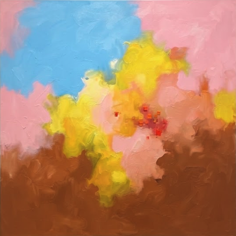

```
Thanks for checking out MemoryNcoLour!
```

# 🏆 MemoryNcoLour 🥈


> 
> 📌 **Project Status: Archived (2026.10.28)**  
> 본 저장소는 **"코디세이 AI Native 1기 Final Project 자유주제부문 2위 수상작"**(2026.10.28.수) 이며
평가가 완료됨에 따라 **아카이빙(Read-Only)** 처리하였으며 본 저장소에서의 추가 개발 및 업데이트는 진행되지 않습니다.
> 
> * 🗓️ **팀 미션 기간:** 2026.10.06 ~ 2026.10.20  
> * 🏛️ **시스템 설계 및 프로젝트 총괄 책임:** 김외진 (KIM OEJIN) / rainbowjjinn@gmail.com  

<br> *thank you*.

> 
> 

※ *코디세이 AI Native 과정은 과학기술정보통신부 주관, 정보통신기획평가원(IITP) 전담, (재)이노베이션 아카데미 수행으로 진행되는 프로젝트 기반 AI·SW 학습 과정입니다.*
<br>
<br>
 ━━━━━━━━━━━━━━━━━━━━━━━━━━━━━━━━━━━━━━━━━━━━━━━━━━━


[🎵 ***The Good Old Days***](./background_music/The%20Good%20Old%20Days.mp3)  

<br>


<!---
<blockquote style="margin-left: 30px;">
  <p>
    🎵 <b>
      <marquee behavior="scroll" direction="right" scrollamount="3" width="280px">
        The Good Old Days
      </marquee>
    </b><br>
    <audio controls preload="none">
      <source src="./background_music/The%20Good%20Old%20Days.mp3" type="audio/mpeg">
    </audio>
  </p>
</blockquote>
--->


# MemoryNcoLour
### [ Memory and Color | My and Color ] 
  - Memory and Color 를 줄여 MaC 이라한다. 

<br>

*당신의 추억을 한 줄로 남겨주세요.  
당신의 기억을,  
색으로 돌려드립니다.*  
<br><br> 

---
### Key ideas:   
Cognitive Externalization  
Synesthetic Visualization  
Chromatic Cryptography / Color Encoding  
Memory Coordinate Mapping  
MaC SPECIMEN code (Standardization)  
Deterministic Color Engine (KS A 0011 · CIELAB · CIEDE2000)  
<br><br>
## Introduction
> ** *What color is your memory?* **  
> 언어로 표현된 개인의 기억을 AI로 해석하여 4색의 디지털 색채 표본(MaC SPECIMEN)과 정량적 HEX 데이터로 환원하는 웹 서비스.
MaC는 보이지 않는 내면의 감각과 기억을 관찰 가능한 색채로 변환하는 시각화 서비스 입니다. 

- **주관적 다의성의 보존**: 타인에게는 단순한 추상 색면이지만, 본인에게는 기억의 공감각적 온도를 복원하는 고유한 암호로 작동합니다.
- **정서의 외재화(Externalization)**: "내가 곧 감정"인 상태에서 벗어나, 내면의 기억을 `#FFB7C5`와 같은 구체적인 데이터 덩어리로 변환하여 객관적으로 마주합니다.
- **MaC SPECIMEN 체계**: 국제 공식 표준이 아닌, MaC 프로젝트만의 독립적인 디지털 기억색 표본 규격으로 상표권 침해 없이 안전하게 결과물을 영구 보존합니다.
- **같은 추억 문장이 입력되면 동일한 hash 값**  AI는 문장을 *읽기만* 하고 색을 *짓지 않습니다*. 색은 KS A 0011 색이름표와 결정론적 색 연산에서 나오므로, 같은 문장(문장급)은 항상 같은 HEX · 색 이름 · 해시를 돌려받습니다.

---
<br><br>
## Main Features

| 기능 | 설명 | 주요 위치 |
| :--- | :--- | :--- |
| **Synthesize Palette** | 기억 한 문장(10~300자) → 4색 팔레트(주조 45% · 보조 30% · 분위기 15% · 강조 10%) + 색 이름 + HEX + MaC SPECIMEN 코드. 결과표를 이메일로 발송 | `js/section01.js`, `api/analyze.py` |
| **Memory Archive** | 큐레이션 작품 10점의 갤러리와 상세 모달 (문장 · 색면추상화 · 컬러칩) | `html/section02.html`, `js/section02.js` |
| **Color Concierge** | 프라이빗 문의 폼. 입력 검증 말풍선 + 비동기 발송 알림 (5초 자동 소멸) | `html/section03.html`, `js/section03.js` |
| **MaC 챗봇** | 저장된 기억 아카이브(Supabase)를 검색해 답하는 컨시어지 챗봇. '추억의 HEX 찾기'로 대화창에서 바로 4색 확인, 음성 입력 지원 | `js/mac-chat.js`, `js/mac-voice-input.js`, `api/chat.py` |
| **Astral Color (사주 기반)** | 생년월일시 → 사주 사주팔자 계산 → 오행 수호색 → 고유색 4 + 보완색 4 = 8색 팔레트 → 조각보 · 전통 화풍 이미지 보고서 | `astral/`, `js/astral*.js`, `api/astral*.py` |
| **Color Oracle** | OKLCH · LCh · HEX 결정론 변환, 문장 → 팔레트(캐시 → 규칙 → 어휘사전 → 새 장면만 LLM 1회), 비슷한 문장 추천 | `oracle/`, `routers/oracle_router.py` |
| **표본 보관함 · 크레딧** | 로그인 회원은 표본을 보관하고, 게스트는 IP당 하루 한도 내에서 이용 | `routers/specimen_router.py`, `routers/auth_router.py` |

<br><br>
## Architecture


```
기억 문장
 ├─ ① 저장소에 같은 문장(sentence_key)이 있으면 그대로 반환           (같은 문장 = 같은 칩)
 ├─ ② Claude : 문장 → 7축 단어 + 기억 질감 + 요약                      (색은 내지 않음, 구조화 출력)
 ├─ ③ 단어 매칭 : 명시 색 → 코퍼스 정확 일치 → Voyage 임베딩(τ) → Claude 후보 고르기(RAG)
 ├─ ④ 면적 : 축 가중치 · 빠진 축 재분배 · 같은 색 합치기 · 파생색
 ├─ ⑤ 칩 4개 + 그림 팔레트 + 그림 지시문 + 표본 코드(MaC-XXXX-XXXX-XXXX)
 └─ ⑥ Supabase 저장(원문 문장은 저장하지 않고 열쇠와 결과만) → 결과 모달 · 이메일(Resend)
```

| 계층 | 역할 | 배포 |
| :--- | :--- | :--- |
| **Frontend** | 단일 페이지(SPA) UI. `index.html` 하나로 통합 실행, 섹션별 `html/ css/ js/` 모듈 원본 유지 | Vercel (정적) |
| **Serverless API** | `/api/analyze`(색 추출 · 컨시어지 · HEX 찾기), `/api/chat`, `/api/astral*` | Vercel Python 함수 |
| **FastAPI 백엔드** | 인증 · 크레딧 · 표본 보관 · Color Oracle · 이미지 우선 엔진 · 보안 미들웨어 | Railway (`uvicorn main:app`) |

<br><br>  


## Tech Stack

| 계층 | 사용 기술 | 설명 |
| :--- | :--- | :--- |
| **Frontend** | HTML5, CSS3, Vanilla JavaScript | 의존성 없는 가벼운 반응형 웹 UI, CSS 그리드 기반 모달 |
| **Frontend UX** | Web Audio API, SpeechRecognition, IntersectionObserver | 어쿠스틱 사운드 피드백, 음성 입력(ko-KR), 스크롤 연동 작품 뷰어 |
| **Backend** | Python 3.12, FastAPI, Uvicorn, slowapi | 인증/크레딧/표본 API, rate limit · UA 차단 · CORS · Cloudflare 가드 |
| **Serverless** | Vercel Python Functions (`api/*.py`) | `BaseHTTPRequestHandler` 기반 핸들러, `maxDuration` 60초 |
| **AI Engine** | Claude (Anthropic Messages 규격, Codyssey 호환 주소) | 문장 나누기 · 후보 고르기 · 챗봇 응답. `temperature=0`, 강제 도구 호출로 JSON 형식 고정 |
| **Embedding / RAG** | Voyage AI `voyage-4-large` (1024차원), NumPy | 단어 코퍼스 1,888단어 / 4,527표기 임베딩 검색. 키가 없으면 글자 비교(ngram)로 대체 |
| **Image** | Gemini image model, OpenAI 호환 이미지 API (`gpt-image-2`) | 기억 색면추상화(gestural 화풍) · Astral 전통 화풍 이미지 |
| **Database** | Supabase (PostgreSQL, RLS, pgvector, Storage) | `mac_results` 장기 기억 저장소, 표본 · 크레딧, 비공개 버킷 `specimens` |
| **Email** | Resend API | 도메인(`mac.ai.kr`) 인증 기반 트랜잭션 이메일 자동 발송 |
| **Security** | AES 암호화(`MEMORY_ENC_KEY`), PII 마스킹, Supabase JWT | 원문/연락처 암호화, LLM 전송 전 개인정보 마스킹, IP 해시 로그 |
| **Data/Color**| KS A 0011 색이름표, JSON, HEX (`#RRGGBB`), sRGB, CIELAB/LCh, OKLCH, CIEDE2000 | 색 199개 + 대체 이름 127개 / MaC 색표본(기억 기반 도출 색표본) |
| **Astral** | astronomy-engine, korean-lunar-calendar, tzdata | 절기 · 음양력 · 출생지 시각 보정 기반 결정론 사주 계산 |

---
<br><br>


## 👥 Team Roles & Work

| 구분 | 담당자 | 역할 | 주요 작업 내용 |
| :---: | :---: | :--- | :--- |
| **1** | **팀장 김외진** | 아이디어 기획 및 디자인 총괄, 오케스트레이션 | - 서비스 아이디어·기획서 작성 (MaC SPECIMEN 개념, 4색 위계 45/30/15/10)<br>- 화면 디자인·레퍼런스 원화·UX 방향 총괄<br>- 색 추출 규칙 정의 (7축 가중치, 팀 색 이름 규칙)<br>- 사용자 피드백 수합 및 엔진 개선 방향 결정 (색면추상화생성, 문장 고정, 화풍 등)<br>- 팀원 작업 통합·일정 조율 총괄, 아이디어회의 관리<br>-자동화 워크플로우: 고객에게 도출된 추억의 색표본 전송|
| **2** | **박세빈** | 독립 섹션 SAZU (Astral Color) | - 사주 오행에 따른 맞춤 컬러 처방 (대표색 4 + 보완색 4 = 8색)<br>- 고유 컬러를 활용한 맞춤 동양화(전통화) 제작<br>- 결정론 사주 계산 엔진 (양·음력, 절기, 출생지 시각 보정)<br>- 조각보 구성·결과 화면·사운드 연출<br>- 생성 한도·익명 세션 등 이미지 생성 운영 |
| **3** | **이태규** | 코퍼스 · RAG · 임베딩 전담 및 후반 작업 | - KS A 0011 색이름표 구축 (사용 색 199개 + 대체 이름 127개)<br>- 단어 코퍼스 구축 (1,888단어 / 4,527표기 / 명시 색 표현 526)<br>- Voyage 임베딩 벡터 생성, 임계값(τ) 평가<br>- 후보 고르기 RAG, 장면·사물·연구 근거 코퍼스<br>-  후반 작업  |
| **4** | **김우혁** | 5개 기술 기능 완성 및 후반 작업 | - **AI Agent**: 컨시어지 챗봇 · 추억의 HEX 찾기<br>- **RAG**: 기억 아카이브 검색 기반 응답<br>- **멀티모달 AI**: 음성 입력, 이미지 생성·측정<br>- **자동화 워크플로우**: 분석 → 저장 → 이메일 발송<br>- **Long-term Memory**: 문장 고정, 표본 보관함<br>- 후반 통합·안정화 |


## 🧩 5대 기술 요소 적용 현황

| 기술 요소 | 설명 | MaC 적용 내용 | 구현 위치 |
| :--- | :--- | :--- | :--- |
| **AI Agent** | 사용자 의도를 파악하고 도구를 활용하여 목표를 달성하는 Agent | 컨시어지 챗봇이 질문 의도를 파악해 서비스 안내, 저장된 기억 검색, '추억의 HEX 찾기'(색 추출), 표본 코드 조회로 연결. Color Oracle은 도구 호출 방식(`tool_schema.json`)으로 색 변환·팔레트 생성 수행 | `api/chat.py`, `js/mac-chat.js`, `oracle/tools.py` |
| **RAG (검색 증강 생성)** | 외부 지식을 검색하여 LLM 응답에 활용 | ① 기억 문장의 단어를 코퍼스·임베딩(Voyage)으로 검색해 KS 색 후보를 찾고 Claude가 후보 중에서만 고름<br>② 챗봇이 저장된 기억 아카이브를 검색해 답변에 주입 | `services/mac_color/matcher.py`, `core/rag.py`, `data/kscorpus/`, `api/chat.py` |
| **멀티모달 AI** | 텍스트, 이미지, 음성 등 다양한 형식의 입출력 처리 | 입력: 텍스트 + 음성(ko-KR 음성 인식). 출력: 색 팔레트 + 색면추상화·전통화 이미지 + 이메일. 그림에서 색을 다시 측정해 검증 | `js/mac-voice-input.js`, `core/image_first.py`, `core/verify.py`, `api/astral_art.py` |
| **자동화 워크플로우** | 여러 서비스를 연동하는 자동화 파이프라인 | 문장 입력 → 분석 → 저장 → 결과표 이메일 자동 발송. 컨시어지 문의는 운영자 메일함으로 자동 전달. 그림 생성 → 검증 → 재생성 루프 | `api/analyze.py`, `utils/mailer.py`, `core/pipeline.py` |
| **Long-term Memory** | 사용자별 대화 기록 및 선호도를 저장·활용 | 같은 문장은 저장된 결과를 재사용(문장 고정), 회원 표본 보관함, 챗봇 대화 기록 10개 유지 | `services/mac_memory.py`, `core/sentence_lock.py`, `core/store.py`, `sql/schema.sql` |
<br><br>
## Deployment URLs

- **Production Service**: `https://mac.ai.kr` (또는 Vercel 배포 도메인)
- **API Server (Railway)**: Railway 배포 주소 — 프론트(Vercel)와 분리 운영, `CORS_ORIGINS`에 프론트 주소를 등록합니다.
- **GitHub Repository**: 'https://github.com/OZ-Codessey/MemoryNcoLour.git'

------------
<br><br>
## API Endpoints

### Serverless (`api/`)

| 메서드 | 경로 | 설명 |
| :---: | :--- | :--- |
| POST | `/api/analyze` | 기억 문장 → 4색 팔레트. `type`으로 분기: (기본) 표본 발송 · `hex_finder` 챗봇용 즉시 반환(메일 없음) · `hex_hash` 표본 코드 계산 · `concierge_inquiry` 컨시어지 문의 |
| GET · POST | `/api/chat` | 컨시어지 챗봇. 저장된 기억을 검색해 시스템 프롬프트에 주입 후 응답 |
| POST | `/api/astral` | 생년월일시 → 사주 프로필 계산 (무료) |
| POST | `/api/astral_report` | 사주 전체 보고서 + 아트워크 패키지 |
| POST | `/api/astral_art` | 보고서 기반 전통 화풍 이미지 생성 (일일/전체 한도 적용) |  
<br>

### FastAPI (`main.py`)

| 메서드 | 경로 | 인증 | 설명 |
| :---: | :--- | :---: | :--- |
| POST | `/api/analyze` | 선택 | 기억 → SPECIMEN. 게스트는 IP당 하루 2회·저장 안 함 / 로그인은 크레딧 1 차감, 보관함 저장 |
| GET | `/api/specimens` · `/api/specimens/{id}` | 필수 | 내 표본 조회 (이미지는 만료되는 signed URL) |
| GET · POST | `/api/me/credits` · `/api/me/credits/claim` | 필수 | 무료 크레딧 (소셜 로그인 · 휴대폰 인증 계정만 1회 지급) |
| POST | `/api/concierge` | 선택 | 컨시어지 문의 (시간당 5회, 연락처 암호화) |
| POST | `/auth/signup` · `/auth/login` | - | 회원가입 · 로그인 |
| GET · PATCH · DELETE | `/auth/me` | 필수 | 내 정보 조회 · 수정 · 탈퇴 |
| GET · POST | `/api/oracle` | - | 결정론 색 변환 (hex2oklch · oklch2hex · hex2lch · lch2hex · scale · step · selfcheck) |
| POST | `/api/palette` | 선택 | 문장 → 팔레트 (게스트는 새 장면 LLM 하루 `ORACLE_LLM_DAILY`회) |
| GET | `/api/palette/similar` · `/gallery` · `/thumb` | - | 비슷한 문장 추천 · 저장된 문장 갤러리 · 썸네일 |
| POST | `/astral` · `/astral/report-preview` | - | Astral 사주 색 계산 |
| GET | `/health` | - | KB 버전 · 검색기 · τ · LLM 모드 · 저장소 상태 |

응답 예 (`/api/analyze`):
```json
{
  "specimen_hash": "MaC-a858432c9fb9",
  "memory_summary": "…",
  "palette": [
    {"role": "dominant", "hex": "#9791AC", "area_ratio": 0.45, "color_name": "Dusk Lavender",
     "lch": [61.6, 15.4, 300.0]}
  ],
  "verification": {"status": "PASS", "max_de00": 0.27},
  "pii_masked": {"전화": 1}, "cache_hit": false, "email_sent": false
}
```

---
<br><br>
## ⚙️ Environment Setup

터미널(Terminal) 환경에서 아래 명령어를 순서대로 실행하여 로컬 개발 환경을 구축합니다.

```bash
# 1. 저장소 복제 및 디렉토리 이동
cd Desktop
git clone https://github.com/OZ-Codessey/MemoryNcoLour.git
cd MaC

# 2. 가상환경 생성 및 활성화 (macOS/Linux, Python 3.12+)
python3 -m venv venv
source venv/bin/activate

# 3. 백엔드 의존성 패키지 설치
pip3 install -r requirements.txt

# (선택) 시험 · 코퍼스/벡터 재생성용 개발 의존성
pip3 install -r requirements-dev.txt
```
<br>  

>##  🔐 Environment Variables  

보안을 위해 모든 API Secret Key는 소스 코드에 커밋하지 않으며, 배포 플랫폼(Vercel · Railway) 및 로컬 환경 변수(.env)를 통해 격리 관리합니다.  
키를 비워 두어도 stub LLM + ngram 검색 + 메모리 저장소로 구동되므로, 키 없이도 구조를 먼저 확인할 수 있습니다.

| 구분 | 항목 / 변수명 | 상세 설명 | 비고 / 발급처 |
| :--- | :--- | :--- | :--- |
| **필수** | `ANTHROPIC_API_KEY` | 문장 나누기 · 후보 고르기 · 챗봇용 Claude Key | Codyssey 콘솔 (`sk-cody-…`) |
| **필수** | `ANTHROPIC_BASE_URL` | Codyssey 키 사용 시 필수 (`https://copa.codyssey.kr`). 없으면 Anthropic 공식 주소 | Codyssey 문서 탭 |
| **필수** | `RESEND_API_KEY` | 분석 결과표 및 컨시어지 의뢰 메일 발송용 Key | [Resend](https://resend.com/) |
| **필수** | `SUPABASE_URL` · `SUPABASE_SERVICE_ROLE_KEY` | `mac_results` 장기 기억 저장소 (서버 전용, 브라우저 노출 금지) | [Supabase](https://supabase.com/) |
| 권장 | `VOYAGE_API_KEY` | 임베딩 검색. 없으면 글자 비교 후보로 대체(정확도 낮음) | [Voyage AI](https://www.voyageai.com/) |
| 선택 | `GEMINI_API_KEY` | 이미지 화가(`PAINTER=gemini`) 또는 예전 방식(`MAC_ENGINE=legacy`) | [Google AI Studio](https://aistudio.google.com/) |
| 선택 | `MAC_ENGINE` | `ks`(기본) / `legacy` — 예전 방식으로 즉시 복귀 | |
| 선택 | `MAC_CHAT_MODEL` · `MAC_CLAUDE_MODEL` | 챗봇 / 색 엔진 Claude 모델 이름 | |
| 선택 | `MAC_TAU` · `MAC_GAP` · `MAC_TOPK` | 임베딩 즉시 수락 기준 0.90 / 2등과 차이 0.02 / 고르기 후보 수 20 | |
| 선택 | `ENGINE_MODE` · `PAINTER` · `PAINT_STYLE` | `palette`/`image_first`, `gemini`/`claude_scene`/`stub`, `gestural`/`color_field` | FastAPI 백엔드 |
| 선택 | `SENTENCE_LOCK` · `SENTENCE_CLASS` | 같은 문장 · 같은 문장급 고정 | FastAPI 백엔드 |
| 보안 | `MEMORY_ENC_KEY` | 원문 · 연락처 암호화 키 (`python -c "import os,base64;print(base64.b64encode(os.urandom(32)).decode())"`) | |
| 보안 | `CORS_ORIGINS` · `CF_ORIGIN_SECRET` · `UA_BLOCK` | 프론트 주소 화이트리스트 · Cloudflare 경유 강제 · 크롤러 차단 | |
| 보안 | `APP_ENV=prod` | `/docs` 비활성, 인증 수단 없으면 부팅 실패 | |
| Astral | `ASTRAL_IMAGE_PROVIDER` · `CODYSSEY_API_KEY` · `ASTRAL_IMAGE_MODEL` | 사주 아트워크 이미지 생성 공급자 / 키 / 모델 | |
| Astral | `ASTRAL_SIGNING_SECRET` · `ASTRAL_PUBLIC_ORIGIN` · `ASTRAL_ART_DB_PATH` | 익명 세션 서명 · 공개 주소 · 영구 볼륨 경로 | Railway Variables |
| Astral | `ASTRAL_IMAGE_DAILY_LIMIT` · `ASTRAL_IMAGE_TOTAL_LIMIT` | 이미지 생성 일일 / 전체 한도 | |
| **로컬 환경 설정** | `.env` 생성 | 프로젝트 루트 디렉토리에 생성 후 발급받은 키 입력 (`.env.example` 활용) | `.gitignore`에 등록되어 GitHub에 노출되지 않음 |
| 📌 **Tip** | `cp .env.example .env` | 로컬 환경 구성 시 터미널에서 템플릿을 복사하여 즉시 환경 변수를 설정할 수 있습니다. | CLI 명령어 |  

> ⚠️ `SUPABASE_SERVICE_ROLE_KEY` 는 모든 RLS를 우회하는 키입니다. 서버 환경 변수에만 두고 프론트 번들에는 절대 넣지 않습니다.

<br> <br>

# 🌐 How to Run  

###  **Option A. Vercel CLI 로컬 구동 (권장)**
프론트엔드와 Python 서버리스 함수(`api/*.py`)를 프로덕션 환경과 동일하게 로컬에서 통합 실행합니다.  
```  
# Vercel CLI 설치 (최초 1회)
npm install -g vercel

# 로컬 통합 개발 서버 구동
vercel dev
```  

### **Option B. FastAPI 백엔드 단독 실행**
인증 · 크레딧 · Color Oracle 등 FastAPI 백엔드만 따로 구동합니다. (`/docs`에서 API 확인)  
```
uvicorn main:app --reload --port 8000
```  
> UA 차단이 켜져 있어 `curl` 기본 User-Agent는 403 입니다. 개발 중에는 `-H 'User-Agent: Mozilla/5.0 dev'` 를 붙이거나 `UA_BLOCK=0` 으로 실행하세요.

### **Option C. 테스트 · 평가 스크립트**
```
python -m pytest -q                        # 단위 테스트 (색 엔진 · 문장 고정 · RAG · Oracle · Astral 등)
python scripts/eval_tau.py                 # 골드셋으로 검색 임계값 τ 평가
python scripts/eval_rag.py --sweep         # 코퍼스 RAG 정답률 / τc 결정
python scripts/try_sentence.py "문장"       # 실제 키로 문장을 넣어 단계별 확인
```
<br>  

## ☁️ Production Deployment

### Vercel (프론트엔드 + 서버리스 함수)
1. Vercel Dashboard 접속 후 MaC 프로젝트 선택  
2. Settings → Environment Variables 탭 이동  
3. Type: Secret 상태로 환경 변수 등록 후 Save:  
>- ANTHROPIC_API_KEY, ANTHROPIC_BASE_URL  
>- RESEND_API_KEY  
>- SUPABASE_URL, SUPABASE_SERVICE_ROLE_KEY  
>- VOYAGE_API_KEY (권장)  
4. `vercel.json` 의 `functions."api/analyze.py".includeFiles` 에 코퍼스 · 벡터 · `services/**` · `prompts/**` · `emailTemplate.html` 이 포함되어 있는지 확인합니다.  
5. Deployments 탭에서 최신 배포 항목의 Redeploy를 실행하여 키를 반영합니다.  

### Railway (FastAPI 백엔드)
1. Supabase SQL Editor 에 `sql/schema.sql`(및 `sql/mac_results.sql`) 실행, Storage 에 비공개 버킷 `specimens` 생성  
2. Railway Variables 에 `.env` 키 입력, `APP_ENV=prod`, `CORS_ORIGINS=https://mac.ai.kr,…` 설정  
3. `railway up` — `railway.json` 의 시작 명령(`uvicorn main:app --host 0.0.0.0 --port ${PORT:-8000}`)과 `/health` 헬스체크 사용  
<br>

### 👮🏼‍♂️ Compliance & Security Notice 
```
1. 독자적 표본 체계: 본 서비스의 색채 표본 체계는 독자적인 MaC SPECIMEN을 기반으로 작동하며, PANTONE®을 포함한 타사 상표권을 침해하지 않습니다.  

2. 보안 격리: 모든 API Key와 인증 토큰은 환경 변수로 암호화 관리되며 클라이언트 번들에 노출되지 않습니다.  

3. 개인정보 보호: 기억 문장은 LLM 전송 전 서버에서 개인정보(전화·이름 등)를 마스킹하고, 저장소에는 원문 대신 문장 열쇠(해시)와 결과만 보관합니다. 접근 로그에는 IP 해시만 남깁니다.  


```
<br><br><br>

 
<details>
<summary><b>🌲 Directory Structure — Frontend (클릭하여 펼치기)</b></summary>

```text
MaC/
├── index.html                  # [Entry Point] 프론트엔드 단일 통합 실행 파일
├── emailTemplate.html          # Resend 발송용 색채 표본 HTML 서식
├── favi.html                   # 파비콘 및 브라우저 메타 태그 컴포넌트
├── requirements.txt            # Python 의존성 (google-genai, resend, astronomy-engine 등)
├── vercel.json                 # Vercel 배포 및 라우팅 제어 설정
├── .python-version             # Python 3.12
├── .env / .env.example         # 로컬 보안 환경 변수 (API Keys)
├── .gitignore                  # Git 추적 제외 설정
├── SERVICE_PLAN.md             # 서비스 기획안 및 정책 정의서
├── README.md                   # 프로젝트 리드미 문서
│
├── api/                        # Vercel Serverless 엔드포인트
│   ├── analyze.py              # 색 추출 · 컨시어지 · HEX 찾기 분기 핸들러
│   ├── chat.py                 # 컨시어지 챗봇 (기억 검색 + Claude 응답)
│   ├── astral.py               # 사주 프로필 계산
│   ├── astral_report.py        # 사주 전체 보고서
│   └── astral_art.py           # 사주 아트워크 이미지 생성 · 한도 관리
│
├── html/                       # [모듈화] 섹션별 분할 마크업
│   ├── main.html               # 공통 골격
│   ├── section01.html          # 히어로/입력폼/상단 네비 모달/결과 모달
│   ├── section02.html          # Memory Archive 갤러리 10점 + 상세 모달
│   └── section03.html          # MaC Concierge 프라이빗 문의 폼
│
├── css/                        # [모듈화] 계층형 스타일시트
│   ├── shared.css              # 전역 리셋, 컬러 시스템, 네비, 공용 모달
│   ├── section01.css           # 히어로 섹션 및 2-컬럼 레이아웃 전용 스타일
│   ├── section02.css           # 갤러리 5열 그리드 및 팝업 상세 스타일
│   ├── section03.css           # 컨시어지 폼 및 상태 안내 바 스타일
│   ├── mac-chat-voice.css      # 챗봇 패널 · 음성 입력 스타일
│   ├── astral.css              # Astral Color 서비스 스타일
│   └── style.css               # 프론트 통합 스타일시트
│
├── js/                         # [모듈화] 인터랙션 스크립트
│   ├── shared.js               # Web Audio 엔진, 네비 모달, Escape 제어
│   ├── section01.js            # 색채 합성 폼 비동기 전송 및 지니 모달
│   ├── section02.js            # 갤러리 데이터 바인딩 및 상세 팝업
│   ├── section03.js            # 컨시어지 5초 자동 복구 UX 피드백
│   ├── mac-chat.js             # 챗봇 UI · '추억의 HEX 찾기'
│   ├── mac-voice-input.js      # 음성 입력(SpeechRecognition + 음량 VAD)
│   ├── astral.js               # 사주 입력 폼 · 보고서 요청
│   ├── astral-hero.js          # 사주 인트로 연출
│   ├── astral-report-ui.js     # 사주 기둥 · 오행 결과 표시
│   ├── astral-jogakbo.js       # 면적 보존 조각보 구성 · 직물 렌더링
│   ├── astral-artwork-view.js  # 아트워크 스크롤 뷰어 (표시 전용)
│   ├── astral-sound.js         # 오음계 기반 사운드 큐
│   └── main.js                 # 프론트엔드 스크립트 통합본
│
├── astral/                     # 결정론 사주 · 색 계산 엔진
│   ├── engine.py               # 사주 계산 · 오행 · 색 산출
│   ├── calendar.py             # 음양력 · 절기 · 시간 보정
│   ├── constants.py            # 천간 · 지지 · 오행 상수
│   ├── palette.py              # 색조 구분 팔레트
│   ├── artwork.py              # 보고서 → 아트 브리프
│   ├── art_store.py            # 아트 결과 저장 (SQLite)
│   ├── public_art.py           # HTTPS 설정 · 서명된 익명 세션
│   └── locations.py            # 출생지 검증
│
├── prompts/                    # AI 추론 프롬프트 엔지니어링 모듈
│   ├── color_prompt.py         # 색채 분석 구조화 시스템 프롬프트
│   └── color_association.py    # 색채 심리 및 감정-색채 매핑 정의 모듈
│
├── services/                   # 비즈니스 로직
│   ├── llm_engine.py           # 모델 호출 체인 · 재시도 · 페일오버 엔진
│   └── mac_memory.py           # Supabase 장기 기억 저장소 (캐시 · 검색)
│
├── assets/                     # Astral 정적 자산 (출생지 목록, 샘플 보고서, 히어로 회화)
├── images/                     # 웹사이트 정적 그래픽 및 원화 자산
│   ├── gallery.png             # 아카이브 전시작 스프라이트 이미지
│   ├── generReference.png      # 레퍼런스 무드 원화 아트워크
│   └── reference.png           # 파비콘 및 참조 심볼
│
└── records/                    # 커밋 스크린샷 및 프로젝트 증빙 기록물
```
</details>  

<details>
<summary><b>🌲 Directory Structure — Backend (클릭하여 펼치기)</b></summary>

```text
backend/
├── main.py                     # [Entry Point] FastAPI 앱 + 보안 미들웨어 + 라우터 등록
├── requirements.txt            # 서버 의존성 (google-genai, resend, numpy 등)
├── requirements-dev.txt        # 시험 · 코퍼스/벡터 재생성용 (pytest, voyageai, colour-science 등)
├── railway.json                # Railway 배포 설정 (uvicorn, /health 헬스체크)
├── vercel.json                 # Vercel 함수 설정 (includeFiles, maxDuration)
├── .env.example                # 환경 변수 템플릿
├── CHANGES_*.md                # 엔진 버전별 변경 문서 (eng-1.1 ~ eng-2.5, ks-1)
├── *.patch                     # 버전별 적용 패치
│
├── api/                        # Vercel Serverless 엔드포인트
│   ├── analyze.py              # 색 추출 · 컨시어지 · HEX 찾기
│   └── chat.py                 # 컨시어지 챗봇
│
├── routers/                    # FastAPI 라우터
│   ├── analyze_router.py       # 기억 → SPECIMEN
│   ├── specimen_router.py      # 표본 보관함 · 크레딧
│   ├── auth_router.py          # 회원가입 · 로그인 · 내 정보
│   ├── concierge_router.py     # 컨시어지 문의
│   ├── oracle_router.py        # Color Oracle · 팔레트 · 갤러리
│   └── astral_router.py        # Astral 사주 색 계산
│
├── core/                       # 색채 파이프라인 핵심
│   ├── pipeline.py             # 전체 흐름 + 생성 → 평가 → 재생성 루프
│   ├── llm.py                  # LLM 특징 추출(구조화 출력) / stub / 임베딩
│   ├── kb.py                   # Color KB · Resolver(키워드 → 라벨 → 검색 ≥ τ → 기본톤)
│   ├── synth.py                # 결정론 LCh 합성 + cache_key
│   ├── color.py                # sRGB ↔ Lab ↔ LCh, CIEDE2000, 색역 클리핑
│   ├── affect.py               # 정서(쾌 · 각성) → 명도 · 채도 보정
│   ├── objects.py              # 기억 속 사물 → 색 등급
│   ├── corpus.py · rag.py      # 코퍼스 로드 · 검색 · 근거 묶음
│   ├── sentence_lock.py        # 같은 문장 고정
│   ├── sentence_class.py       # 같은 문장급 고정
│   ├── image_first.py          # 그림 먼저 엔진 (gestural 화풍)
│   ├── render.py · verify.py   # 코드 그림 / K-Means(Lab) + ΔE00 검증
│   ├── pii.py                  # LLM 전송 전 개인정보 마스킹
│   ├── astral_palette.py       # 사주 4색 + 보완색 4색 = 8색 팔레트
│   └── store.py                # Supabase / 메모리 저장소, 크레딧, 게스트 한도
│
├── services/                   # KS A 0011 색 엔진
│   ├── mac_memory.py           # Supabase 장기 기억 저장소
│   └── mac_color/              # data · matcher · palette · prompts · keys · clients · pipeline
│
├── oracle/                     # Color Oracle (OKLCH 변환 · 문장 → 팔레트 · 비슷한 문장)
├── astral_color/               # 사주 계산 엔진 (결정론)
├── prompts/                    # 특징 추출 · 색채 프롬프트
├── utils/                      # auth · crypto · limiter · mailer · supabase_client
├── sql/                        # schema.sql (테이블 · RLS · pgvector · 크레딧 RPC), mac_results.sql
├── scripts/                    # 평가(eval_*) · 임베딩 빌드 · 코퍼스 빌드 · 문장 시험
├── tests/                      # pytest 단위 테스트
├── examples/                   # frontend_fetch.js (프론트 호출 예시)
│
└── data/
    ├── color_kb.json           # 데모 Color KB (수치는 예시값 · status=demo)
    ├── goldset*.jsonl          # τ · RAG 평가용 골드셋
    ├── corpus/                 # 장면 · 사물 · 연구 근거 코퍼스 (scenes / objects / research)
    └── kscorpus/               # KS 색이름표 · 단어 코퍼스 · 임베딩 벡터 · 검토용 xlsx
```
</details>  

<br>

## 💬 User Feedback & Improvements

| No. | 사용자가 문장을 넣고 본 문제 (피드백) | 원인 | 개선 내용 |
| :---: | :--- | :--- | :--- |
| **1** | "수박·옥수수"를 넣었는데 결과 색에 사물이 드러나고, 주조색과 강조색 이름이 둘 다 "Peach Cream"으로 나옴. | 사물·장소·시간 카테고리 축에서만 색을 가져옴 | 사물이 드러나지 않도록 프롬프트를 보강하고 도출된 컬러는 면적비에 차등을 둠 |
| **2** | 비교적 색상 위주로 쨍한 컬러감이 많음.| 감정 카테고리 가충지 비율 조정이 필요 | 정서 등 감정 카테고리에 가중치를 조정하고 부사를 채도 명도 조절용으로 흡수 시킴 |
| **3** | 팀장이 색이 골고루 발현되지않다고 피드백 | 팔레트를 먼저 계산한 뒤 4색으로 그림을 그려서 늘 정확히 4색이었습니다. | 문맥 분석 후 모델에 주입되는 hex의 개수에 제한을 두지 않고, 완성된 그림에서 4개의 색표본을 추출하는 방법으로 하여 그림의 색감을 풍부하게 함. |
| **4** | 같은 문장을 3분 간격으로 넣었는데 해시와 HEX가 달랐다. 고객이 두 번 뽑아도 해시·HEX·색상·색 이름이 같아야 한다. | 캐시가 서버 메모리뿐이라 재시작하거나 다른 인스턴스로 가면 다시 계산했고, 그림에서 측정하니 HEX가 흔들렸습니다. | 문장 고정(`sentence_lock`)을 넣어 영구 저장소에서 같은 결과를 재사용하게 했습니다. 즉 hash 값이 일정하게 나오도록 함|
| **5** | "엄마와 함께 수박을 먹은"과 "엄마랑 같이 수박 먹었던"처럼 말투만 달라도 색이 달라졌습니다. | 문장부호와 띄어쓰기만 무시해서, 조사·어미가 다르면 다른 문장으로 처리했습니다. | 같은 문장급(조사·어미·시제·어순만 다름)을 같은 표본으로 묶었습니다. 해시는 "문장 + 4색"에서 생성해 검증할 수 있게 했습니다. |
| **6** | "초여름 툇마루에서 엄마와 수박을 먹던 기억"을 넣었더니 그림 가운데에 수박 조각이 그려졌고, 눈·입을 가진 얼굴처럼 보였습니다. 아래에는 마루 원근선도 그려졌습니다. | 금지 지시문이 있었지만, 같은 지시문에서 "기억 속 사물: 수박"이라고 이름을 알려 줬습니다. | 사물 이름 대신 색 말("선명한 빨강")만 llm 에게 전달합니다. 사물 조각, 얼굴처럼 읽히는 배치, 원근선도 금지했습니다. |
| **7** | 그림이 형태가 고정되는 감이 있고  레퍼런스의 붓 자국·번짐·물감 튐 같은 질감이 없었습니다. | 지시문이 "큰 색면 3~6개"로 고정이었습니다. | 표현적 추상(gestural) 화풍을 기본으로 바꿨습니다. 화풍을 지정해 주고, 기법 및 재료가 드러나게 레퍼런스를 보강 |
| **8** | 색 이름이 영문인 경우 등 모델이 지어낸 이름이었으나 따라서 HEX도 같은 문장에서도 다름 | AI가 색 이름과 HEX를 직접 생성했습니다. | AI는 문장 나누기와 후보 고르기만 하고, 색은  KS A 0011 색이름표(199색)에서 나오게 했습니다. |

<br>

```
🔮 중요
MaC 은 의료·치료용 서비스가 아니며, 추상적인 언어 기억을 정량적 디지털 데이터(HEX)로 변환해 소장성과 창작 영감을 제공하는 색채 아카이빙 서비스 입니다. 그러나 제작자의 의도와는 무관하게 드물게는 개인에 따라 치료나 치유 효과를 줄 수는 있습니다.
```
