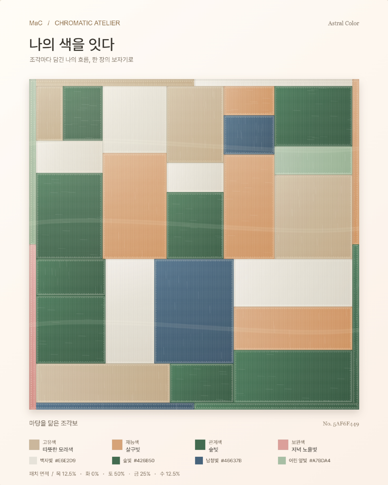
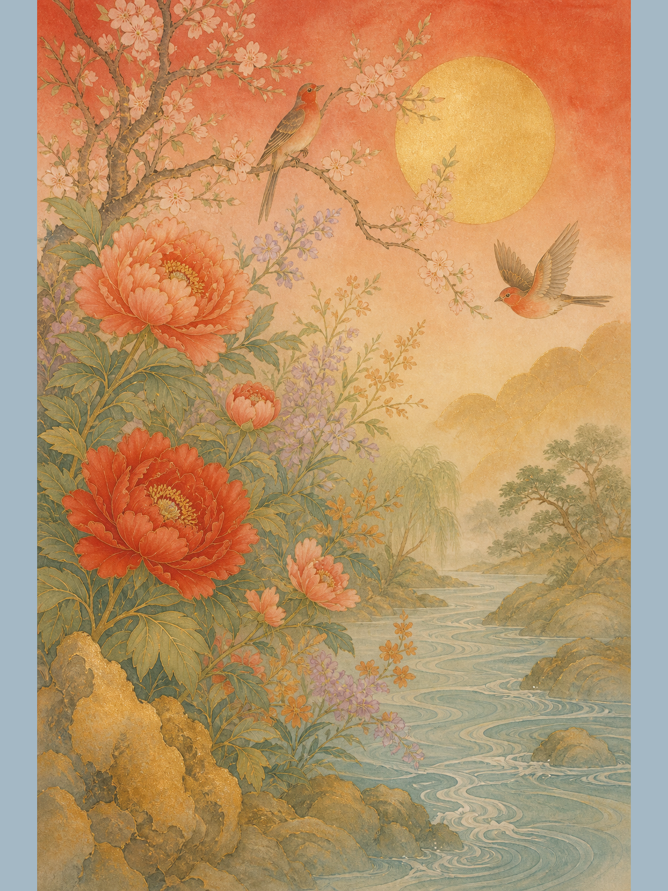

# Astral Color — 사주를 나만의 색과 전통화로 연결하는 서비스

작성일: 2026-10-19  
프로젝트: MaC / Astral Color  
소스 저장소: [ssebni/MaC_astral-color](https://github.com/ssebni/MaC_astral-color)  
문서 기준: 로컬 `codex/astral-color` 브랜치의 `c88c7ac`와 개발 대화 기록

문서 용도: 최종 발표·제출용

> 구현 내용과 해결 과정, 시각 디자인의 발전을 정리한다. 개발 일정은 프로젝트 담당자가 전달한 확정 일정을 기준으로 작성했다. 코드 구현, 실제 외부 API 검증, MaC 운영 사이트 반영 여부는 서로 구분한다.

## 1. 서비스 개요

Astral Color는 출생정보를 바탕으로 계산한 사주를 일상적인 설명과 개인화된 색상으로 풀어주고, 그 결과를 한국 전통 채색화로 연결하는 웹 서비스다. 어려운 용어를 읽고 끝내는 대신, 나의 특징을 색으로 이해하고 하나의 작품으로 감상·저장하는 경험을 제공한다.

핵심 흐름은 다음과 같다.

**출생정보 입력 → 사주 계산 → 쉬운 요약과 대표색 확인 → 최종 8색 확정 → 개인 맞춤 전통화 생성 → 작품 이야기·확대 감상·PNG 저장**

네 가지 색상 분야는 고유색·재능색·관계색·보완색이다. 각 분야에서 두 색을 제공하므로 회화에 사용하는 최종 팔레트는 총 8색이다. 이 색상 연결은 MaC의 해석·디자인 규칙이며, 전통 명리의 유일한 색상 정답이나 운을 바꾸는 처방으로 제시하지 않는다.

## 2. 문제정의

### 2.1 해결하려는 사용자 문제

아래 문제는 개발 과정의 화면 검토와 피드백에서 도출한 가설이며, 전체 사주 서비스 시장에 대한 조사 결과는 아니다.

| 문제 | 개발 중 확인한 사례 | 해결 방향 |
| --- | --- | --- |
| 사주 결과를 이해하기 어렵다 | 일간·월령·십신 중심의 설명, 한 번에 읽히지 않는 요약 | 계산 근거는 내부에 유지하고 생활 속 언어로 설명 |
| 색이 왜 필요한지 직관적이지 않다 | 도출 과정만 길게 설명하거나 상단 요약과 카드가 중복 | 짧은 선정 맥락·색의 의미·활용법으로 역할 분리 |
| 개인화된 결과의 차이가 잘 보이지 않는다 | 두 색이 같거나 재능색과 관계색이 순서만 바뀜 | 분야별 선정 맥락 분리, 조합 충돌 방지, 최종 8색 톤 보정 |
| 결과를 감상·소장하는 경험이 부족하다 | 초기 패턴은 색상 시각화 중심 | 개인화된 전통화와 작품 이야기, 원본 다운로드 제공 |
| 서비스 통합 시 화면만 연결되고 생성은 실패한다 | 정적 파일 경로, POST API, 티켓, 이미지 요청 규격 문제 | 프론트·계산 서버·이미지 공급자의 책임과 검증 단계 분리 |

### 2.2 해결 목표

- 사주를 모르는 사람도 자신의 결과와 색의 의미를 설명할 수 있게 한다.
- 화면에서 확인한 색과 전통화 제작에 전달하는 색을 일치시킨다.
- MaC의 크림·베이지 톤 안에서 전통미와 개인화된 감상을 제공한다.
- 생성 실패와 비용 발생을 사용자가 통제할 수 있는 구조로 만든다.

의료·재무·진로 등 중요한 결정을 대신하거나 사주 해석의 과학적 타당성을 입증하는 것은 서비스 목표가 아니다.

## 3. 타겟 사용자와 사용 시나리오

**핵심 타겟: 사주에 대한 기본적인 관심을 바탕으로 자기이해와 개인화된 콘텐츠를 선호하는 사람.**

연령·성별로 범위를 임의로 한정하지 않고, 관심사와 콘텐츠 이용 동기를 중심으로 정의한다.

### 주요 타겟

- 사주에 관심은 있지만 전문 용어와 긴 풀이에는 익숙하지 않은 사용자
- 자기이해를 개인화된 색·이미지 콘텐츠로 경험하고 싶은 사용자
- 한국 전통미를 현대적인 웹 경험으로 감상하고 작품을 소장하고 싶은 사용자

### 대표 시나리오

1. 출생정보를 입력하고, 시간 미상 여부와 출생지역을 확인한다.
2. 한줄 요약과 만세력·오행 분포를 통해 결과의 큰 흐름을 살핀다.
3. 대표색 패널을 눌러 두 색의 의미와 일상 활용법을 확인한다.
4. 결과 하단에서 전통화 생성을 요청하고 사용되는 8색을 확인한다.
5. 완성된 작품을 족자 형태로 감상하고, 확대 모달과 작품 이야기를 본다.
6. 원본 PNG를 저장한다.

## 4. AI 활용방식

### 4.1 계산과 생성의 역할 분리

**AI에게 출생정보를 주고 사주를 다시 판단하게 하지 않는다.** 사주 계산·색 선정·중복 보정은 Python 코드가 수행한다. 생성형 AI는 이미 확정한 해석과 팔레트를 그림으로 표현하는 단계에 사용한다.

| 단계 | 처리 주체 | 처리 내용 |
| --- | --- | --- |
| 달력·시각 처리와 사주팔자 계산 | 규칙 기반 Python 코드 | 양·음력, 절입, 과거 시간대, 시간 미상 처리 |
| 풀이·대표색·한줄 요약 | 테이블·템플릿·검증 코드 | 기존 해석의 일상 언어화, 분야별 두 색 선정 |
| 최종 8색 보정 | CIELCH 색상 처리 코드 | 색 이름과 색상각을 유지하며 명도·채도 조절 |
| 화풍·상징물·구도 결정 | 작품 제작 지시 생성 코드 | 기존 재능 주제를 화조민화·책거리·산수 채색화와 연결 |
| 전통화 이미지 생성 | Codyssey 이미지 API를 통한 생성형 모델 | 확정된 제작 지시와 최종 8색을 회화로 표현 |
| 작품 이야기 | 제작 지시 기반 설명 템플릿 | 작품 의도와 요청한 오브제의 의미 설명 |

한줄 요약과 작품 이야기는 별도의 외부 언어모델 호출 없이 생성한다. 작품 이야기는 실제 이미지에서 오브제를 인식한 결과가 아니므로, 요청한 오브제가 그림에 반드시 등장한다고 단정해서는 안 된다.

### 4.2 이미지 생성 입력과 제약

`astral/artwork.py`에서 계산 완료 보고서를 작품 제작 지시로 변환한다. 팔자·검토된 풀이·분포·최종 8색을 사용하며 이름·생년월일·출생시각·도시·성별 원문을 이미지 프롬프트에 넣지 않는다. 성별 입력은 선택된 미술 연출 방향으로만 변환한다.

- 한국 전통 채색화 기반의 컬러 작품으로 생성한다.
- 한지·비단·천연 안료와 전통 붓질의 느낌을 지시한다.
- 최종 8색을 모두 사용하되 면적은 같게 강제하지 않는다.
- 글자·낙관·서명·로고·워터마크와 현대 소품·서양 판타지를 배제한다.
- 꽃잎에는 검정·회색·탁한 무채색·강한 파란색을, 잎에는 검정·회색·탁한 무채색을 배치하지 않는다.
- 여러 꽃 종류에는 적합한 팔레트 색을 다르게 배정한다. 적합한 색이 부족하면 새 색을 만들지 않고 꽃 종류를 줄인다.
- 사주 재계산, 기운 부족의 치료, 건강·수명·운의 보장을 금지한다.

### 4.3 모델 활용의 한계

현재 코드의 기본 설정 모델명은 `gpt-image-2`이며 Codyssey 어댑터를 사용한다. 이는 저장소 설정을 설명한 것으로 공급자의 최신 모델 제공 여부를 보증하지 않는다. 실제 키의 생성 권한·지원 크기·남은 사용량은 운영 환경에서 별도 확인해야 한다.

같은 입력의 사주 계산·팔레트 보정은 일정하게 유지하지만, 새로 생성하는 그림의 구도와 픽셀까지 동일하지는 않다. 목표 HEX를 전달한다고 실제 그림의 모든 색이 그 값과 정확히 일치하는 것도 아니다. 색상·화풍·오브제·금지 요소는 실제 생성 결과의 육안 검수가 필요하다.

## 5. 기술적 접근 방식

### 5.1 구성과 데이터 흐름

```text
브라우저: HTML / CSS / JavaScript
  │ 출생정보 POST
  ▼
/api/astral_report — Python 계산·보고서 API
  ├─ 달력·시간대·사주 계산
  ├─ 해석·4분야 × 2색·LCH 보정
  └─ 작품 제작 지시·서명 티켓 반환
       │ 사용자가 생성 요청
       ▼
/api/astral_art — 티켓·설정·요청 한도 검증
  ├─ 로컬 캐시 / 공개 파일럿의 SQLite 한도·캐시
  └─ 서버의 비밀 키로 Codyssey 이미지 API 호출
       ▼
원본 PNG + 작품 이야기 → 족자 표시 / 확대 / 다운로드
```

### 5.2 핵심 기술과 선택 이유

| 영역 | 구현 | 선택 이유 |
| --- | --- | --- |
| 화면 | HTML·CSS·JavaScript | 기존 MaC 프론트에 전용 파일 단위로 결합 |
| 사주 계산 | Python, `astronomy-engine`, `korean-lunar-calendar`, `zoneinfo`·`tzdata` | 절입·음력·과거 표준시를 명시적인 규칙으로 처리 |
| 지역 검증 | 프론트·서버가 공유하는 `birth-locations.json` | 임의 지역명과 잘못된 지역 조합 차단 |
| 팔레트 | CIELCH(D50), CIE76 색차 | 원래 색 계열을 유지하며 유사색을 구분 |
| 회화 생성 | Python HTTP 어댑터, Codyssey `b64_json` 응답 | 공급자의 실제 요청·응답 구조와 호환 |
| 작품 표시 | 공통 SVG 표구·원통형 축봉·클립 애니메이션 | 생성 원본을 훼손하지 않고 일관된 족자 경험 제공 |
| 오디오 | Web Audio 합성 효과음 | 외부 녹음 에셋 없이 UI·펼침 타이밍에 맞춘 사운드 |
| 저장 | 선택적 Supabase 시연, 공개 생성용 SQLite | 계산 결과 최소 저장과 생성 한도·캐시를 구분 |
| 검증 | Python unittest·Node 기반 테스트 | 계산·팔레트·API·UI 회귀 검증 분리 |

### 5.3 계산·입력 정책

국내 출생, 1948~2050년 범위, 양력·한국 음력과 윤달, 출생시각 또는 시간 미상을 처리한다. 연주는 입춘, 월주는 절입 순간, 일주는 현지 시계의 자정을 기준으로 한다. 현재 국내 계산은 당시 `Asia/Seoul` 표준시를 적용하며 진태양시는 적용하지 않는다.

해외 출생 국가 선택 UI는 있지만 해외 사주 계산은 지원하지 않는다. 지원하지 않는 입력을 서울 시간으로 임의 계산하지 않고 안내한다. 국가 선택 가능과 계산 지원은 별개의 상태다.

### 5.4 최종 8색의 일관성

색 이름·선정 의미와 CIELCH의 H를 유지하고 L·C만 조정한다. 서로 다른 HEX라도 지나치게 유사하면 보정 대상이다. 최종 8색의 28개 쌍에 대해 CIE76 색차 12 이상을 검사하며, HEX 양자화 후 유채색 H 오차도 검사한다. 이는 서비스 디자인 기준이지 모든 화면·색각에서의 구별을 보장하는 기준은 아니다.

보정된 값을 보고서·컬러칩·HEX 복사·다운로드 PNG의 팔레트 메타데이터·그림 생성 프롬프트가 공유한다. 다운로드 메타데이터 기록은 원화 픽셀의 재색칠과 다르며, 원본 픽셀은 유지한다.

### 5.5 보안·비용·운영

- API 키는 서버 환경변수에 보관하고 프론트·Git·문서에 포함하지 않는다.
- 사주 결과 조회 자체로 이미지 API를 호출하지 않는다. 사용자의 생성 요청 후 호출한다.
- 서명 티켓으로 계산 결과와 생성 요청을 연결하고 변조·만료를 검증한다.
- 공개 파일럿은 같은 원점, 익명 세션, 영구 저장소의 생성 한도와 캐시를 사용한다.
- 실패를 자동 재시도하지 않고, 중복 생성·늦게 도착한 응답·입력 변경을 제어한다.
- Supabase 시연 저장은 명시적으로 켠 경우에만 최소 계산 항목을 저장한다. 출생일·시각·도시는 저장하지 않는다.
- 공개 생성은 Railway 단일 인스턴스 파일럿을 전제로 한다. 대규모 서비스에는 공유 큐·저장소·사용자 인증·봇 차단·운영 모니터링이 추가로 필요하다.

## 6. 해결 과정과 주요 의사결정

### 6.1 사주 설명을 ‘도출 근거’에서 ‘사용자 이해’ 중심으로 변경

초기에는 전문 용어와 계산 근거가 화면에 많이 드러났다. 이후 상단은 짧은 선정 맥락과 두 색의 간단한 의미로, 각 카드는 상세 풀이와 생활 활용법으로 분리했다. 반복되는 하단 설명은 제거하고 A·B 대신 색 이름을 표시했다. 한줄 요약도 두 가지 성향과 네 대표색을 연결하되, ‘읽혀·어우러져’처럼 어미가 반복되는 표현을 개선했다.

### 6.2 분야별 색상 중복과 8색 유사도를 단계적으로 해결

처음에는 같은 분야의 두 색이 같았고, 이를 구분한 뒤에는 재능색과 관계색이 순서만 바뀌는 경우가 남았다. 실제 계산 맥락 안에서 후보를 재선정하고 분야 조합 충돌을 검사했다. 이어 모든 8색을 비교하는 결정적 톤 보정으로 확장했으며, 최종적으로 LCH의 H와 색 이름을 유지하는 방식으로 구체화했다.

### 6.3 조각보에서 개인 맞춤 전통화로 확장

전통문양과 조각보는 코드로 색의 배치와 면적을 표현하기에 적합했지만, 개인의 이야기를 풍경과 오브제로 담는 데에는 표현 범위가 제한됐다. 확정된 사주 결과와 8색을 작품 제작 지시로 변환해 화조민화·책거리·산수 채색화로 확장했다. 오브제의 의미는 난해한 사주 용어 대신 배움·표현·관계·여유 같은 일상 언어로 풀었다.

### 6.4 API 호환성과 실패 원인을 단계별로 분리

Codyssey 발급 키는 OpenAI 공식 서버의 키가 아니므로 공급자 전용 이미지 주소와 응답 구조를 사용하도록 연결했다. 지원하지 않는 이미지 크기의 거절 응답도 확인하여 Codyssey에는 지원 세로 규격인 `1024x1536`을 요청하도록 분기했다.

MaC 통합 과정에서는 `file://` 지역 JSON 접근, `aria-hidden`과 포커스 충돌, GET으로 이미지 주소를 열었을 때의 `Method not allowed`, POST 생성 요청의 티켓 오류 등을 구분했다. 주소창의 GET 오류는 생성 POST 실패와 같은 증거가 아니며, 보고서의 `configured: true`도 이미지 생성 성공을 뜻하지 않는다. 실제 생성 요청의 메서드·본문·전체 응답·서버 로그를 함께 확인해야 한다.

### 6.5 그림 원본과 화면 장식을 분리

처음의 성별·팔레트에 따른 바깥 여백 대신 모든 작품에 같은 따뜻한 아이보리 표구를 적용했다. 하단 봉이 내려오는 족자 펼침과 종이·천 마찰 합성음을 연결하고s, 작품을 누르면 장식 없이 원본 전체를 확대한다. 모달은 어디든 클릭하거나 Esc로 닫을 수 있다. PNG 저장에는 표구를 합성하지 않으므로 원화의 색과 구도를 유지한다.

## 7. 버전 업 이미지

### 7.1 시각 디자인의 세 가지 버전

아래는 각 단계의 실제 화면 또는 사용자가 제공한 이미지다. 사주 계산·색 선정 규칙도 함께 발전했으므로, 같은 입력을 동일한 조건으로 렌더링한 엄밀한 비교 실험은 아니다.

#### 디자인 v1 — 전통문양 컬러패턴


- 기록: 2026-10-08 첨부 화면에서 패턴을 추출한 자료
- 표현: 중앙 문양과 장식 테두리에 대표색을 배치
- 의미: 사주 색상 결과를 한국적 조형 언어로 시각화한 출발점
- 다음 단계: 정해진 장식 문양보다 색의 관계와 면적을 유연하게 표현하도록 조각보로 확장

#### 디자인 v2 — 8색 조각보



- 기록: 2026-10-12 첨부 화면 기반 아카이브
- 표현: 분야별 두 색, 직물의 결·쌈솔·조각의 면 분할
- 의미: 개인별 색을 하나의 천처럼 연결하는 경험
- 주의: 오행 면적비는 시각화 기준이며 사주의 강약·용신을 뜻하지 않음
- 다음 단계: 색의 배치를 넘어 오브제와 풍경으로 개인의 이야기를 표현하도록 전통화로 확장

#### 디자인 v3 — 개인 맞춤 한국 전통 채색화



- 기록: 저장소에 2026-10-14 자료로 보관된 사용자 제공 전통화 예시
- 표현: 확정된 해석·최종 8색·화풍·상징물·구도를 결합한 생성형 작품
- 의미: 결과를 읽는 데서 감상하고 저장하는 경험으로 확장
- 이후 UX: 공통 아이보리 족자·수직 펼침·동기화 효과음·원본 확대 모달 추가
- 주의: 이 이미지는 전통화 단계의 예시이며 최신 프롬프트의 모든 개선을 검증한 결과 이미지는 아님

### 7.2 전통화 도입 이후의 네 차례 색상·프롬프트 개선

‘디자인 v1~v3’와 아래 ‘전통화 기준본+4회 수정’은 다른 버전 체계다. 내부 작품 지시 버전, 보고서 버전, 디자인 단계가 같은 번호를 뜻하지 않는다.

| 순서 | Git 기록일 | 문제와 수정 내용 | 확인 커밋 |
| --- | --- | --- | --- |
| 수정 1 | 2026-10-14 | 꽃잎·잎의 부자연스러운 무채색 등을 제한하고 적합한 대상으로 색을 배치 | `f13e4f9` |
| 수정 2 | 2026-10-14 | 8색 전체의 동일 HEX를 결정적으로 명도·채도 보정 | `cd7ad02` |
| 수정 3 | 2026-10-15 | 동일색뿐 아니라 유사색까지 LCH H·이름을 유지하며 보정 | `0da9761` |
| 수정 4 | 2026-10-15 | 여러 꽃 종류의 적합한 색을 다르게 배정하고 부족하면 꽃 종류 축소 | `deb89fb` |

이 네 커밋 기준으로 ‘기준본 이후 4회 개선’이 확인된다. 모든 개발 기간의 프롬프트·UI 변경을 통틀어 네 번뿐이었다는 뜻은 아니다. 이전 README에서 제거한 V1~V5 비교판은 이 문서 작성만으로 저장소에 다시 추가하지 않았다.

## 8. 일정 계획

개발 기간은 **2026년 10월 5일~10월 15일**이다. 아래는 프로젝트 담당자가 전달한 확정 일정이며, 버전 이미지의 기록일이나 Git 커밋일과는 구분한다.

| 날짜 | 개발 단계 | 진행 내용 |
| --- | --- | --- |
| 10/05 | 개발 시작 | Astral 서비스 개발 시작 |
| 10/07 | 기본 화면 구성 | 기본 레이아웃 완성 |
| 10/09 | 사주 패턴 개발 | 사주 패턴 생성 프롬프트 디벨롭 |
| 10/11 | 조각보 개발 | 사주 조각보 생성 프롬프트 디벨롭 |
| 10/13 | 전통화 방향 확정 | 사주 전통화 생성 프롬프트 디벨롭 및 확정 |
| 10/15 | 개발 완료 | Astral 서비스 최종 완료 |

10월 15일의 완료는 Astral 서비스 개발 마일스톤을 의미한다. 이후의 MaC 본 서비스 통합·배포 지원과 운영 검증은 별도 과정으로 구분한다.

## 9. 검증과 남은 과제

### 현재 코드에 마련된 검증

- 달력·절입·시간 미상·지역 입력과 계산 오류 경계 테스트
- 같은 입력의 팔레트 결정성, 최종 8색 간 색차, 프롬프트·화면·다운로드의 값 일치 테스트
- 모의 이미지 응답을 사용한 PNG 형식·픽셀 보존·팔레트 메타데이터 테스트
- 티켓 변조·만료, 요청 한도·캐시·저장소 장애·공급자별 요청 형식 테스트
- 족자 펼침·효과음·확대 모달·다운로드 흐름의 모의 UI 테스트

이는 저장소의 테스트 구성 설명이며, 본 문서 작성 시 전체 테스트를 새로 실행하거나 실제 과금 API를 호출한 것은 아니다. 사용자 제공 작품 예시와 모의 API 테스트만으로 최신 통합본의 운영 성공을 보증하지 않는다.

### 후속 검증

- 명리 전문가의 야자시 정책 검토와 역서 표본 대조
- 해외 도시·역사적 시간대 연결 및 경계 검증 후 해외 계산 지원 여부 결정
- 실제 이미지의 팔레트 재현·꽃색·화풍·오브제 검수
- 성별 기본 연출을 사용자가 직접 고르는 스타일 옵션으로 확장할지 검토
- 최신 MaC 통합본의 실제 API 호출·Supabase·배포 경로 점검
- 사용자 이해도·생성 성공률·응답 시간·비용 측정

## 10. 기대 효과와 확인할 지표

기대 효과는 사주 결과의 이해 장벽을 낮추고, MaC의 개인화된 색 경험을 전통 예술 감상으로 확장하는 것이다. 아직 사용자 조사·운영 측정으로 효과를 입증한 것은 아니다.

향후에는 결과 이해도, 결과→전통화 생성 전환율, 생성 성공률·대기시간, 다운로드 이용률, 중복 요청률, 작품당 비용을 측정한다. 근거 없는 만족도·정확도·성능 수치는 기재하지 않는다.

### 최종 운영·인수인계를 위한 후속 정리

1. 확정된 개발 일정에 맞춰 담당자별 역할과 인수인계 내용을 보완
2. MaC 운영 사이트에서 사주 결과·전통화 생성이 연결된 최신 상태 확인
3. 최신 프롬프트 결과의 대표 작품과 생성 조건을 추가 기록

### 작성 근거

- 저장소의 `README.md`, `docs/ASTRAL_COLOR.md`, `docs/TRADITIONAL_ART.md`, `docs/BIRTH_LOCATIONS.md`, `docs/DEPLOYMENT.md`
- `astral/engine.py`, `astral/palette.py`, `astral/artwork.py`, `api/astral_art.py`와 Git 변경 이력
- 저장소의 `docs/pattern-history/`에 보관된 사용자 제공 이미지
- 개발 과정에서 사용자가 전달한 피드백·통합 오류 자료
- 프로젝트 담당자가 전달한 2026-10-05~10-15 개발 일정

문서의 버전 이미지는 `images/` 폴더를 함께 두어야 표시된다. 이미지 경로를 유지한 채 ZIP 전체를 풀거나 같은 구조로 저장소에 올린다. 개인 출생정보·API 키·환경 파일은 본 자료에 포함하지 않았다.
