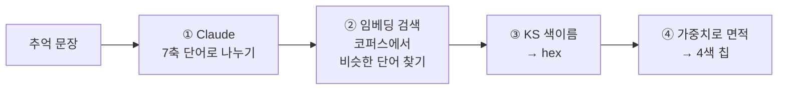
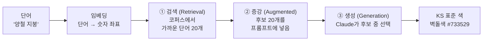
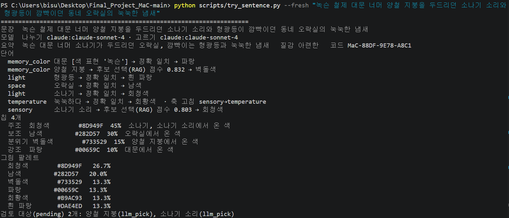
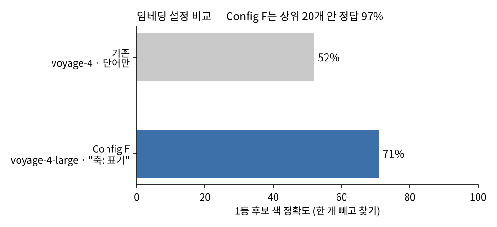
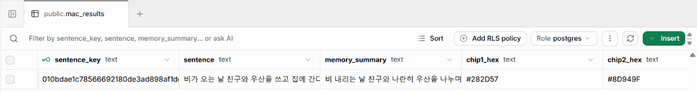
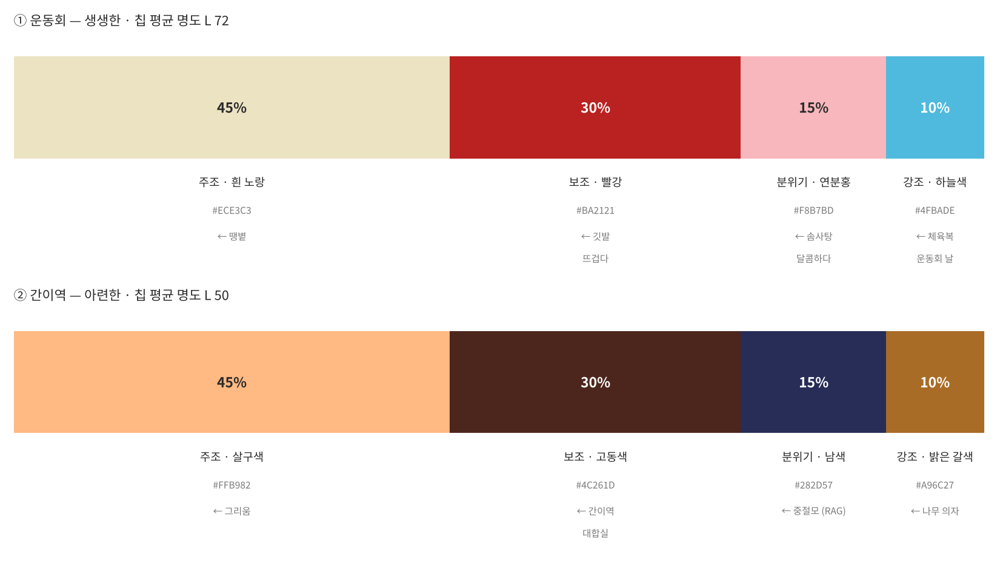

# MaC — 코퍼스 · 임베딩 · RAG (2번 라인)

> 작성: 이태규 · 2026-10-19
> **⚠ 백로그 작업입니다.** 서비스는 1번 라인(MVP + 색면추상화)으로 가고, 이 작업은 개인 작업으로 정리해 **백로그로 전환**합니다.
> **현재 진전:** 임베딩 · RAG 모두 실제 키로 정상 동작 확인 (10/19) · 문장 → KS 4색 칩까지 백엔드 단독 실행 가능

---

## 한 줄 요약

**"LLM은 문장을 읽기만 하고, 색은 국가 표준 색표에서 찾는다."**
LLM이 색 코드를 즉석에서 지어내면 같은 문장도 매번 다른 색이 나옵니다. 그래서 색을 KS A 0011 표준 색이름 안에서만 고르고, 단어와 색을 잇는 사전(코퍼스)을 검색(RAG)하는 구조를 만들었습니다.

---

## 흐름



| 단계 | 예: "녹슨 철제 대문 너머 양철 지붕을 두드리던 소나기 소리와 형광등이 깜빡이던 동네 오락실의 눅눅한 냄새" |
| :--- | :--- |
| ① 나누기 | 대문 · 양철 지붕(사물), 형광등 · 소나기(빛), 오락실(공간), 눅눅하다(온도), 소나기 소리(감각). 색은 말하지 않음. 감정은 문장에서 추론 |
| ② 검색 | "오락실"은 코퍼스에 그대로 있음 → 바로 찾음. "양철 지붕"은 없음 → 임베딩으로 비슷한 단어 검색 (RAG) |
| ③ 색 | 오락실 → 남색 #282D57, 양철 지붕 → 벽돌색 #733529 … |
| ④ 칩 | 팀 7축 가중치로 면적을 나누고 큰 순 4색 = 칩 |

---

## 핵심 AI 기술 — RAG

| 기술 요소 | 설명 | MaC 적용 예시 |
| :--- | :--- | :--- |
| **RAG** (검색 증강 생성) | 외부 지식을 검색하여 LLM 응답에 활용 | 표준 색 코퍼스에서 비슷한 단어를 검색해, Claude가 그 후보 안에서만 색을 고르게 함 |



**왜 RAG인가.** LLM에게 색을 그냥 물으면 그럴듯한 색 코드를 지어내고, 같은 문장에도 매번 다른 답을 냅니다. RAG는 먼저 믿을 수 있는 자료(표준 색 코퍼스)를 검색하고, LLM은 **검색된 후보 안에서만** 고르게 합니다. 후보 밖의 답은 버리므로 색을 지어낼 수 없습니다.

**검색이 확실하면 LLM을 부르지 않습니다.** 코퍼스에 같은 단어가 있거나 임베딩 유사도가 0.90 이상이면 바로 그 색을 쓰고, 애매한 단어만 ②·③으로 넘깁니다.

### 실제 실행 결과 (2026-10-19, 실제 Claude · Voyage 키)

```text
light        형광등       → 정확 일치                  → 흰 파랑   ← 코퍼스에 있는 단어
space        오락실       → 정확 일치                  → 남색
memory_color 양철 지붕    → 후보 선택(RAG) 점수 0.832  → 벽돌색   ← 0.90 미만 → Claude가 후보 20개 중 선택
sensory      소나기 소리  → 후보 선택(RAG) 점수 0.803  → 회청색
sensory      풀 비린내    → 임베딩 점수 0.907          → 연두색   ← 0.90 이상 → 검색 결과 바로 사용 (다른 문장)
```

- **0.90 이상**이면 검색 결과를 그대로 쓰고, **0.90 미만**이면 검색한 후보 안에서 Claude가 고릅니다(RAG). 후보 밖의 색은 고를 수 없습니다.
- RAG로 정해진 단어(양철 지붕, 소나기 소리)는 `검토 대상`으로 남겨 코퍼스 보강에 씁니다.



*실제 실행 화면 — 단어마다 정확 일치 · 후보 선택(RAG) 경로와 유사도 점수, 그리고 최종 칩 4개가 출력됩니다.*

---

## 사용 기술 전체

| 기술 요소 | 설명 | MaC 적용 예시 |
| :--- | :--- | :--- |
| **KS A 0011** | 국가 표준 색이름 (산호색, 진한 파랑 등) | 모든 색은 이 이름 안에서만 고름 (쓰는 색 199개) |
| **색 변환** (먼셀 → LCh · hex) | 표준 색 표기를 화면 색 코드로 바꾸는 계산 | 이름마다 hex를 한 번만 계산해 고정 → 같은 이름 = 같은 색 |
| **코퍼스** | 단어와 색을 잇는 사전 | 7축 단어 1,888개(표기 4,527개)를 KS 색이름에 연결 |
| **임베딩** (Voyage) | 단어를 1,024개 숫자로 된 좌표로 바꾸는 모델. 뜻이 비슷하면 좌표가 가까움 | 사전에 없는 단어도 가장 가까운 단어의 색을 빌려 옴 |
| **코사인 유사도** | 두 좌표가 얼마나 같은 방향인지 재는 값 (1에 가까울수록 비슷) | 0.90 이상이면 바로 그 색을 씀 |
| **LLM** (Claude) | 문장을 이해하는 언어 모델 | 문장 나누기 + 후보 고르기 (문장당 최대 2번) |
| **해시** (SHA-256) | 같은 입력에 늘 같은 코드를 내는 함수 | 같은 문장이면 저장된 결과를 다시 써서 같은 칩 |

---

## 결과 수치

| 항목 | 결과 |
| :--- | :--- |
| 임베딩 설정 비교 | 1등 후보 색 정확도 **52% → 71%**, 상위 20개 안에 정답 **97%** |
| 결정성 | 같은 문장 100번 → 칩·코드 100번 모두 같음 |
| 시험 | 자동 시험 17개 통과, 실제 키로 나누기 · 임베딩 · RAG 확인 |

### 임베딩 설정은 어떻게 골랐나



같은 Voyage라도 모델과 입력 방식에 따라 검색 품질이 달라서, 6가지 설정을 같은 방법으로 비교했습니다.

- **재는 방법:** 코퍼스에서 단어 하나를 빼고, 남은 단어 중 가장 가까운 단어를 찾게 합니다. 찾은 단어의 색이 원래 단어의 색과 같으면 정답입니다. 정답을 이미 아는 코퍼스로 "검색이 색을 맞게 찾아오는가"를 잴 수 있습니다.
- **결과:** 처음 방식(작은 모델 · 단어만)은 52%, 확정한 방식(큰 모델 `voyage-4-large` · `"축: 단어"` 형식)은 **71%**입니다. 단어 앞에 축(예: `space: 바닷가`)을 붙이면, 같은 단어라도 장소로 쓰였는지 사물로 쓰였는지 구분되어 정확도가 올라갔습니다.
- **RAG와의 관계:** 1등만 보면 71%지만, **상위 20개 안에는 정답이 97%** 들어 있습니다. 그래서 1등이 확실하지 않을 때는 상위 20개를 Claude에게 넘겨 고르게 했습니다. RAG 후보 수를 20으로 정한 근거입니다.

### 같은 문장 = 같은 결과



*Supabase `mac_results` — 문장마다 고유 키(`sentence_key`), 요약, 칩 색이 저장됩니다. 같은 문장이 다시 들어오면 이 결과를 그대로 씁니다.*

---

## 버전업 경과

| 날짜 | 버전 | 내용 |
| :--- | :--- | :--- |
| 10/11~13 | KB 방식 | 키워드 사전 + 문맥 판정, 정답률 61% → 70% |
| 10/15 | 방향 전환 | 팀 재논의: KB 폐기, KS A 0011 단일 기준, Voyage 임베딩 |
| 10/16~17 | KS 코퍼스 | 표준 색표 199색 · 단어 코퍼스 · 임베딩 설정 6종 비교 |
| 10/18 | KS 엔진 | 나누기·고르기 Claude 전환, Supabase 저장 |
| 10/19 | 백로그 | 임베딩 · RAG 실제 키 동작 확인, 백로그 전환 |

---

## 데이터 예시

단어 하나가 색이 되기까지를 실제 파일로 따라갑니다. 예: **귤 → 귤색 #F19B00** (연탄난로 문장 실행에서 실제로 나온 결과)

**③ 색 JSON** — KS 색이름표(`ks_colors.json`)의 실제 항목

```json
{
  "name": "귤색",
  "kind": "관용",
  "systematic": "노란 주황",
  "base": "주황",
  "combo": "노란 주황",
  "modifier": "",
  "english": "tangerine",
  "ks_page": 12,
  "munsell": "7.5YR 7/14",
  "hex": "#F19B00",
  "lch": { "L": 70.97, "C": 79.06, "h": 72.86 },
  "lch_munsell": { "L": 70.88, "C": 87.08, "h": 72.78 },
  "gamut_mapped": true,
  "de_mapped": 1.69,
  "value_from": "KS 직접"
}
```

- `munsell`: KS A 0011 표 8의 대표값. 모든 색 값은 여기서 계산됩니다.
- `lch_munsell` → `lch`: 먼셀값 그대로는 화면에 담기지 않아 채도를 87 → 79로 줄였습니다(`gamut_mapped`). 눈으로 본 차이는 ΔE00 1.69로 거의 구분되지 않습니다.
- `hex`: 칩에 실제로 쓰이는 값입니다.

단어 사전에는 색 코드가 없고 색이름만 있습니다. 색 코드는 표준 색표 한 곳에만 있어서, 같은 색이름에 다른 코드가 붙을 수 없습니다.

---

## 테스트 — 느낌이 다른 두 문장

> 분위기가 반대인 두 문장으로 테스트를 실행해, 칩이 기억의 분위기를 따라 달라지는지 확인했습니다. (2026-10-18, 실제 Claude · Voyage 키)

| | ① 밝고 생생한 기억 | ② 고요하고 아련한 기억 |
| :--- | :--- | :--- |
| 문장 | 운동회 날 하늘색 체육복을 입고 청군 깃발을 흔들며 이어달리기를 응원하던 땡볕 아래 운동장, 입안 가득 퍼지던 달콤한 솜사탕 | 해 질 무렵 텅 빈 시골 간이역 대합실, 먼지 앉은 나무 의자에 앉아 막차를 기다리던 할아버지의 낡은 중절모 |
| 기억 질감 | 생생한 | 아련한 |
| 단어 경로 | 정확 일치 8 · 명시 색 1 | 정확 일치 5 · **RAG 2** (중절모 0.823, 먼지 0.758) |
| 칩 평균 명도 | **L 72** (밝음) | **L 50** (어두움) |
| 표본 코드 | MaC-E5F8-8799-E537 | MaC-80FF-2C94-FAA9 |



**확인된 것**
- **분위기가 칩에 드러납니다.** 운동회는 밝은 노랑·빨강·분홍·하늘색, 간이역은 살구색·고동색·남색·갈색으로 갈렸고, 칩 평균 명도가 72 대 50으로 크게 차이 납니다.
- **명시 색이 이깁니다.** "하늘색 체육복" → 하늘색.
- **RAG가 처음 보는 표현을 처리합니다.** "중절모"는 코퍼스에 없어 후보 중에서 남색을, "먼지"는 올리브색을 골랐습니다.
- **같은 색은 합쳐집니다.** 간이역 · 대합실(둘 다 고동색), 깃발 · 뜨겁다(둘 다 빨강) 등이 한 칩으로 합쳐져 면적이 커졌습니다.

**찾은 문제**
- **"청군 깃발"이 빨강이 되었습니다.** "청군"을 색 표현으로 잡았지만 명시 색 표에 없어서 무시되고, "깃발"의 기본 색(빨강)이 쓰였습니다. 파란 팀 깃발이 빨강 보조색(30%)이 된 셈입니다. 앞서 "녹슨 대문 → 파랑"과 같은 원인이라 백로그 6번에 근거를 더했습니다.
- **기저 정서가 주조색이 아닐 수 있습니다.** ①의 감정 "신남"(노란 주황, 15%)은 빛 "땡볕"(20%)보다 가중치가 낮아 칩에 들지 못했습니다. 팀 가중치(빛 .20 > 감정 .15)대로 나온 결과입니다.

---

## 피드백과 반영 

최종 버전 전에 팀장님 및 멘토님 그리고 지인들에게 테스트 후 받은 피드백이 지금의 구조를 만드는데 도움이 되었습니다.

| 날짜 | 누구 | 피드백 | 반영 → 최종 결과물 |
| :--- | :--- | :--- | :--- |
| 10/12 | 팀장 | 같은 단어도 문맥에 따라 감정이 다르다 (아빠 · 혼자 · 비 · 가족). 조사 · 활용형도 고려할 것 | 문맥 판정과 활용형 매칭 도입 → 최종 코퍼스에서는 한 단어에 KS 색 후보 여럿을 두고 문장 맥락으로 고르는 **맥락 색**으로 이어짐 |
| 10/15 | 테스터1 | 색 기준이 흔들리면 안 된다. 모든 색은 KS A 0011 색이름에서 나와야 한다 | 기존 KB 폐기. **색이름표와 단어 사전을 분리**해 hex는 색이름표 한 곳에서만 나오게 재설계 |
| 10/18 | 테스터2 | 같은 문장을 다시 넣으면 같은 결과, 결과는 Supabase에 저장 | 문장 고유 키(`sentence_key`)로 저장 · 재사용 → 같은 문장 = 같은 칩 · 같은 코드 |

---

## 백로그

1. **실제 문장으로 정확도 측정** — 지금 수치(71% · 97%)는 코퍼스 안에서 잰 값. 실제 추억 문장으로 다시 재고, Claude가 후보 20개 중 정답을 고르는 비율과 기준값(0.90)도 함께 확인
2. **코퍼스 보강 고리** — 버려진 단어 · RAG로 고른 단어를 검토해 코퍼스에 추가 → 다음부터는 바로 찾음 (LLM 호출 감소, 같은 단어 = 같은 색)
3. **문장 속 색 표현 지키기** — "녹슨", "청군" 같은 표현이 무시되고, 사물이 여럿이면 "빨간 목도리"의 빨강이 칩에서 빠짐. 팀 원칙 "명시 색 우선"을 지키도록 수정 *(10/19 테스트에서 발견)*
